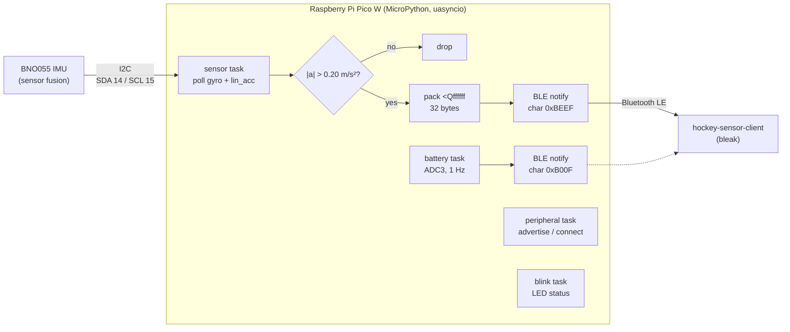

# hockey-sensor

MicroPython firmware for a motion sensor that lives inside the cap of a hockey stick. A Raspberry Pi Pico W reads gyroscope and linear-acceleration data from an Adafruit BNO055 IMU, drops samples that are just sensor noise, packs each remaining sample into a 32-byte binary record, and streams it to a laptop over Bluetooth LE. A desktop client then detects shots, classifies them as wrist, snap or slap, and estimates their speed.

The project is split across two repositories:

| Repository | Role |
| --- | --- |
| **hockey-sensor** (this repo) | Firmware on the stick: IMU sampling, noise gate, binary packing, BLE peripheral, battery and LED status |
| [hockey-sensor-client](https://github.com/Alexirlixer/hockey-sensor-client) | Laptop side: BLE client, data collection, LSTM shot classifier, speed estimate, training data and the research paper |

A write-up of the whole project is on the portfolio site: [alexirlixer.github.io](https://alexirlixer.github.io/#hockey).

## How it works



1. **Sampling.** `sensor.py` opens I2C bus 1 on GP14 (SDA) / GP15 (SCL) and runs the BNO055 in its NDOF fusion mode. A `monitor` coroutine reads the gyroscope (deg/s) and the fused *linear* acceleration (m/s², gravity already removed by the sensor), then yields for 1 ms.
2. **Noise gate.** It computes the magnitude `sqrt(ax² + ay² + az²)` of the linear acceleration. If it is 0.20 m/s² or less, the sample is discarded on the device and never transmitted.
3. **Packing.** Samples that pass are prefixed with a `time.ticks_us()` timestamp and packed with `struct.pack("<Qffffff", ...)`.
4. **Transport.** `service.py` registers a GATT service and pushes each packed sample to the connected central with a notification. Notifications are only sent while a client is connected.
5. **Housekeeping.** A battery task reads the supply voltage once a second and notifies it on a second characteristic, and an LED task shows whether a client is connected.

`main.py` creates all of these as `uasyncio` tasks and runs them together with `asyncio.gather`.

## BLE interface

This is the contract between the firmware and [hockey-sensor-client](https://github.com/Alexirlixer/hockey-sensor-client).

| Item | Value |
| --- | --- |
| Advertised name | `hockey-sensor` |
| Advertising interval | 250 ms (`aioble.advertise` takes microseconds: `250_000`) |
| Appearance | `0x0482` (Cycling: Speed Sensor) |
| Service UUID | `0xBEEF` (128-bit form `0000beef-0000-1000-8000-00805f9b34fb`) |
| Measurement characteristic | `0xBEEF`, read + notify, one sample per notification |
| Battery characteristic | `0xB00F` (`0000b00f-0000-1000-8000-00805f9b34fb`), read + notify, once per second |

The service and the measurement characteristic deliberately share the UUID `0xBEEF`; the client passes that one UUID to both its scan filter and `start_notify`.

### Measurement payload: `<Qffffff`, 32 bytes, little-endian

| Offset | Size | Type | Field | Unit |
| ---: | ---: | --- | --- | --- |
| 0 | 8 | `uint64` | timestamp from `time.ticks_us()` | µs |
| 8 | 4 | `float32` | gyro x | deg/s |
| 12 | 4 | `float32` | gyro y | deg/s |
| 16 | 4 | `float32` | gyro z | deg/s |
| 20 | 4 | `float32` | linear acceleration x | m/s² |
| 24 | 4 | `float32` | linear acceleration y | m/s² |
| 28 | 4 | `float32` | linear acceleration z | m/s² |

The client decodes it with `struct.unpack("<Qffffff", data)`. A 32-byte notification is larger than the 20 bytes allowed by the default 23-byte ATT MTU, so it depends on an MTU of at least 35 being negotiated when the client connects. The recorded sessions in the client repo show that this worked with the hardware and laptop used.

### Battery payload: `<f`, 4 bytes

A single little-endian `float32` holding the supply voltage in volts, computed as `read_u16() * 3.23 * 3 / 65535`. The Pico W measures VSYS through a 1:3 divider on ADC3 (GPIO29), and 3.23 V is the ADC reference value used here.

## Engineering highlights

**Gating noise on the device, not the laptop.** Even at rest the BNO055 reports small non-zero linear acceleration. A stationary recording in the client repo (`data/data-static.csv`) contains essentially nothing above 0.20 m/s², so the firmware throws those samples away before they reach the radio. The gate runs on the magnitude of the vector, so it does not depend on how the stick is oriented. The result is that BLE airtime is spent on motion: a stick lying on the bench sends almost nothing, and a stick being swung streams continuously.

**Compact binary records instead of text.** Seven values go out as one fixed 32-byte struct: a 64-bit timestamp and six 32-bit floats. The equivalent printed CSV line (see the client's recorded data) is about three times larger and would need parsing. A fixed layout also makes the wire format easy to state exactly, and both sides use the same format string.

**Timestamps from the sender.** Each sample carries the microsecond tick at which it was read on the Pico, not the time it arrived on the laptop. BLE delivers notifications in batches per connection event, so arrival times on the laptop are irregular. Because the client groups samples into 250 ms buckets using these device timestamps, BLE jitter does not change which bucket a sample falls into.

**Cooperative concurrency on a microcontroller.** Four independent jobs share one core without threads: sensor polling, the BLE peripheral loop, the battery report and the LED. Each is a `uasyncio` coroutine that does a short piece of work and then awaits. The pieces are decoupled with plain callbacks. `service.make_service_task()` returns the peripheral task together with the two publish functions, and `main.py` passes those functions into the sensor and battery tasks. As a result `sensor.py` has no BLE code in it, and the BLE layer has no knowledge of the IMU.

**Connection-aware peripheral loop.** `peripheral_task` advertises, waits for a single central, sets an `asyncio.Event` while it is connected, and goes back to advertising when the central disconnects. The publish functions check that event, so samples taken with no client connected are dropped instead of queuing up. The LED reads the same event: solid on while connected, blinking while advertising.

**Using the IMU's own sensor fusion.** In NDOF mode the BNO055 fuses its accelerometer, gyroscope and magnetometer on-chip and provides linear acceleration with gravity removed. The Pico does no filtering math beyond the magnitude check, which keeps the loop short. The stick's orientation also does not show up as a constant 9.8 m/s² offset, which would otherwise swamp the shot signal.

**Packaged inside the stick.** The Pico W, the BNO055 and a lithium-ion battery sit in a 3D-printed TPU cap that replaces the stick's normal end cap. It is longer than a stock cap so it can hold the electronics, but that extra length sits inside the shaft, so the stick's playing length does not change. The client README has the design sketch.

## Hardware

| Part | Notes |
| --- | --- |
| Raspberry Pi Pico W | Runs MicroPython with Bluetooth support |
| Adafruit BNO055 9-DOF IMU | I2C address `0x28`, I2C bus 1, SDA on GP14, SCL on GP15 |
| Lithium-ion battery | Powers the board through VSYS; voltage reported on characteristic `0xB00F` |
| 3D-printed TPU stick cap | Holds the three parts above at the top of the stick |

## Running it

1. **Flash MicroPython.** Download the MicroPython firmware for the Pico W (version 1.20 or later, which includes Bluetooth) from [micropython.org/download/RPI_PICO_W](https://micropython.org/download/RPI_PICO_W/). Hold BOOTSEL while plugging in the board and copy the `.uf2` onto the `RPI-RP2` drive that appears.
2. **Install `aioble`.** `service.py` depends on [aioble](https://github.com/micropython/micropython-lib/tree/master/micropython/bluetooth/aioble) from micropython-lib:
   ```sh
   pip install mpremote
   mpremote mip install aioble
   ```
3. **Copy the firmware.** From the repository root:
   ```sh
   mpremote cp bno055_base.py bno055.py sensor.py service.py main.py :
   ```
   `bno055.py` and `bno055_base.py` are Peter Hinch's MIT-licensed [micropython-bno055](https://github.com/micropython-IMU/micropython-bno055) driver, included here unmodified so that the copy step above is all you need. The `.vscode/` folder is set up for the MicroPico extension (`paulober.pico-w-go`) if you would rather upload from VS Code.
4. **Run.** Reset or power-cycle the board. `main.py` runs at boot and the board starts advertising as `hockey-sensor`. To watch its log (`main enter`, `calibrated`, `Connection from ...`), run `mpremote repl` before resetting.
5. **Connect a client.** Use [hockey-sensor-client](https://github.com/Alexirlixer/hockey-sensor-client): `collect.py` records a session to CSV, and `live.py` runs real-time shot detection.

## Files

| File | Purpose |
| --- | --- |
| `main.py` | Entry point; creates the sensor, BLE, battery and LED tasks and gathers them |
| `sensor.py` | IMU setup, polling loop, noise gate, `<Qffffff` packing, battery voltage task |
| `service.py` | GATT service and characteristics, advertising and connection loop, publish callbacks, LED status |
| `bno055.py`, `bno055_base.py` | Vendored MicroPython BNO055 driver (MIT, Radomir Dopieralski / Peter Hinch) |

## Known limitations

- **Timestamp wraparound.** `time.ticks_us()` wraps every 2³⁰ µs, which is about 17.9 minutes. The field is sent as a `uint64`, but the value inside it still wraps, so a consumer that compares timestamps across a wrap will see time go backwards. Every recorded session in the client repo is shorter than one wrap period.
- **Repeated samples.** The loop polls faster than the BNO055 updates its fused outputs. In the recorded sessions the median spacing between samples is 4 to 7 ms, and 17 to 36% of consecutive samples are exact repeats of the one before.
- **Blocking LED blink.** While advertising, `blink_state` calls the blocking `time.sleep(0.5)`, which pauses every other task for half a second. Once a client is connected it only sets the LED, so streaming is not affected.
- **Battery data is not used yet.** The client does not subscribe to `0xB00F`.
- **Calibration is only logged.** The firmware prints `calibrated` when the BNO055 reports full calibration, but it streams data either way.
